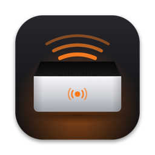
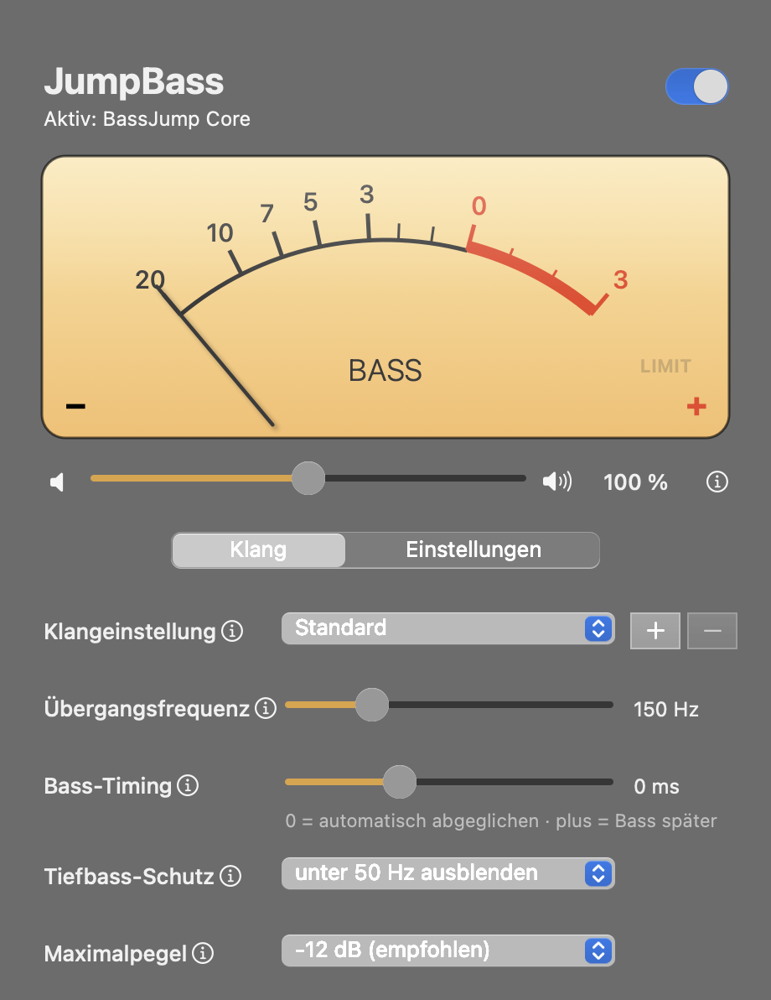
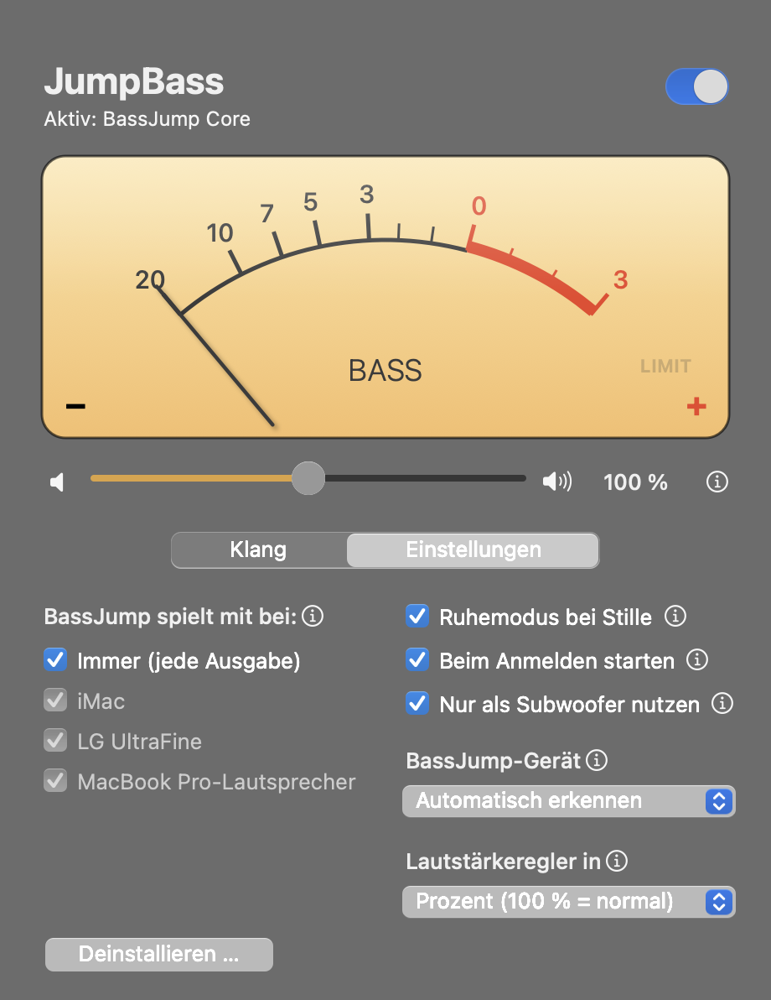
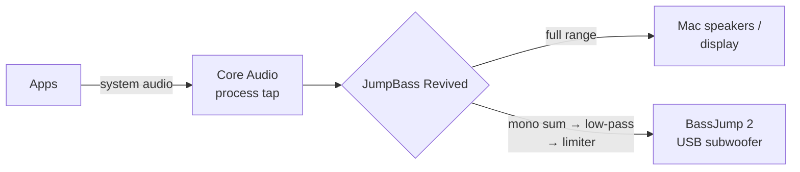

<p align="center">
  
</p>

<h1 align="center">JumpBass Revived</h1>

<p align="center">
  Brings the <b>Twelve South BassJump 2</b> USB subwoofer back to life on current macOS.<br>
  No driver, no kernel extension – just a small menu bar app.
</p>

---

The original BassJump software has not been maintained for years. It stopped working reliably
around macOS High Sierra and does not run on Apple Silicon at all. The hardware itself, however,
is a plain USB audio device – all that is missing is the crossover that sends only the bass to it.
That is exactly what JumpBass Revived does.

> **Note:** JumpBass Revived is an independent open-source project and is not affiliated with,
> endorsed by, or connected to Twelve South. "BassJump" and "Twelve South" are trademarks of their
> respective owners and are used here only to identify the compatible hardware.

<p align="center">
  
  
</p>

<p align="center"><sub>The user interface is currently in German.</sub></p>

## Features

- **Crossover:** Linkwitz-Riley low-pass (24 dB/octave), crossover frequency 40–500 Hz
- **In sync:** speakers and subwoofer are fed from the same buffer; latency differences between
  the devices are compensated automatically (fine-tuning from −100 to +200 ms)
- **Volume** in percent or decibels, automatically follows the Mac's volume and mute – with loudness
  compensation (the bass is lowered less than the speakers, because hearing loses bass at low volume)
- **External displays:** for monitors without macOS volume control (DisplayPort/HDMI, e.g. LG UltraFine)
  the bass follows the volume and mute set in [MonitorControl](https://github.com/MonitorControl/MonitorControl) via DDC
- **Presets:** 16 built-in ones plus any number of your own, which store all sound settings
- **Protection against distortion:** sub-bass filter (high-pass for frequencies the small driver
  cannot reproduce) and a look-ahead limiter whose ceiling is set below the measured clipping point
  of the BassJump's amplifier; a LIMIT lamp in the VU meter shows when it engages
- **Subwoofer only:** the BassJump also registers as microphone and speaker ("BassJump Core");
  JumpBass prevents macOS from making it the default input or output (dictation, Siri, calls, alerts)
- **Standby:** after 10 s of silence the BassJump is released and muted; playback resumes automatically
- **Selectable outputs:** e.g. only with the MacBook speakers and the external display, not with headphones
- **Interface:** window with an analog VU meter and an ⓘ explanation for every setting, plus quick
  access from the menu bar (icon derived from the app icon, greyed out when inactive)
- **Universal binary:** Intel and Apple Silicon

## How it works



The BassJump identifies itself as a USB Audio Class device (C-Media, VID `0x0D8C`, PID `0x013A`),
so macOS drives it without any driver. JumpBass Revived

1. captures the system audio through a process tap (excluding its own process) and mutes the original output,
2. builds a private aggregate device from the current output device (as clock source) and the BassJump
   (with drift compensation),
3. sends the full-range signal to the speakers and the filtered mono sum to the BassJump in the same
   audio callback, aligned in time through delay lines.

If the app quits or crashes, macOS immediately restores the original output.

The code consists of two Objective-C files: `main.m` (audio, menu bar, settings) and
`MainWindow.m` (window and VU meter).

## Requirements

| macOS | How it works |
|---|---|
| **14.2 Sonoma and later** | No additional software required. System audio is captured with a Core Audio process tap. |
| **10.13 High Sierra – 14.1** | Requires a virtual loopback device such as the free [BlackHole 2ch](https://github.com/ExistentialAudio/BlackHole). |

Tested with a BassJump 2 on a MacBook Pro (Apple Silicon) running macOS 15 Sequoia, with the MacBook
speakers and an LG UltraFine display (volume via MonitorControl). The clipping point and the display's
volume curve were measured acoustically with the MacBook microphone.
The BlackHole path for older systems is implemented but has not yet been tested on real hardware.

## Installation

1. Download `JumpBass-Revived-x.y.dmg` from the Releases page, open it and drag the app to Applications.
2. The app is not notarized by Apple. On first launch, right-click the app → **Open**, or on macOS 15+
   go to *System Settings → Privacy & Security → Open Anyway*.
3. On first launch, macOS asks for the **Screen & System Audio Recording** permission – please allow it.
   Microphone access is not needed.
4. Plug in the BassJump. It is detected automatically and the JumpBass icon appears in the menu bar.
5. Enable "Beim Anmelden starten" (launch at login) in the window under *Einstellungen* (settings).

### Building from source

Only the Xcode command line tools are required (`xcode-select --install`), no Xcode project:

```sh
./build.sh        # builds build/JumpBass Revived.app
./make-dmg.sh     # additionally builds build/JumpBass-Revived-<version>.dmg
```

The icon is drawn by `icon/make_icon.m` and included ready-made as `icon/AppIcon.icns`.

### Removing the old Twelve South software

Leftovers of the original software (HAL plug-in, kernel extension, launch daemons) should be removed:

```sh
sudo ./alte-software-entfernen.sh
```

### macOS 10.13 – 14.1 (with BlackHole)

1. Install BlackHole 2ch and select it as output in *System Settings → Sound*.
2. In the menu bar menu, choose **Tonquelle** (source) → "Loopback: BlackHole 2ch".
3. Under **Vollton weiterleiten an** (pass full range to), choose the Mac speakers.

## Settings

| Setting (German UI) | Meaning |
|---|---|
| Lautstärke (volume) | 100 % = normal, 200 % = +24 dB. Applies on top of the device volume and sets the bass/speaker balance. The bass follows the device volume at 0.6 dB per dB. |
| Übergangsfrequenz (crossover) | The BassJump plays up to this frequency. Default 150 Hz; above ~250 Hz it becomes audible as a separate source. |
| Bass-Timing | 0 = automatic, based on device latencies. Positive delays the bass, negative delays the speakers. |
| Tiefbass-Schutz (sub-bass filter) | Removes frequencies below 30–70 Hz that the small driver cannot reproduce. Default 50 Hz: measured, 40 Hz comes out more than 10 dB quieter than 60 Hz but clips just as early. |
| Maximalpegel (maximum level) | Ceiling of the limiter, default -12 dB. Measured: the BassJump's amplifier clips from about -10 dBFS, so higher levels are not offered. |
| Ruhemodus (standby) | Releases the BassJump during silence (saves CPU, lets the BassJump enter its own standby; no audible hiss difference was measured). |
| BassJump spielt mit bei (play with) | Output devices for which the bass is added. |
| Nur als Subwoofer nutzen (subwoofer only) | Switches the default input/output back if macOS selects the BassJump. |

## Uninstalling

In the window under *Einstellungen → Deinstallieren …*. The app removes its login item, settings and
permissions and moves itself to the Trash. Alternatively: `./deinstallieren.sh`.

## Troubleshooting

- **No bass, level meter stays empty:** check *Privacy & Security → Screen & System Audio Recording*.
- **BassJump not detected:** select it manually in the window under *BassJump-Gerät* (device).
- **Distortion at high volume:** a hardware limit of the small, USB-powered amplifier. The default
  ceiling of -12 dB already stays below it; if it still crackles, lower the maximum level or raise the
  sub-bass filter. If LIMIT is lit all the time, the BassJump volume is set too high.
- **Bass does not follow an external display's volume:** the display has no macOS volume control. Use
  MonitorControl to set its volume; JumpBass reads it from there.
- **Diagnostics:** `JUMPBASS_DEBUG=1 "/Applications/JumpBass Revived.app/Contents/MacOS/JumpBassRevived"`
  prints status, levels and latencies to the terminal.

## Origin and legal notice

JumpBass Revived is a **complete re-implementation**. The original Twelve South software served
solely as **inspiration** for features and user experience:

- **No code** of the original software was decompiled, disassembled, copied or modified.
- Only freely readable parts were looked at: the contents of the installer package, configuration
  files (e.g. the default crossover frequency and the sound presets), human-readable names inside the
  program files, and the user interface. Ideas were taken from these – no code.
- The icon, VU meter and interface were drawn from scratch; no images, texts or files from
  Twelve South are used or distributed.
- The BassJump itself is a standards-compliant USB audio device that macOS supports without a driver.

This repository and its source code are meant to help other BassJump owners and to serve as
inspiration for their own solutions. Use at your own risk and without warranty.

## Built with Claude Code

This project was developed together with [Claude Code](https://claude.com/claude-code), Anthropic's
AI coding assistant – from analysing the original installer and the audio engine to the interface,
icon and this README.

## License

[MIT](LICENSE) © 2026 klehart – free to use, modify and distribute as long as the copyright
notice is retained. No warranty.
